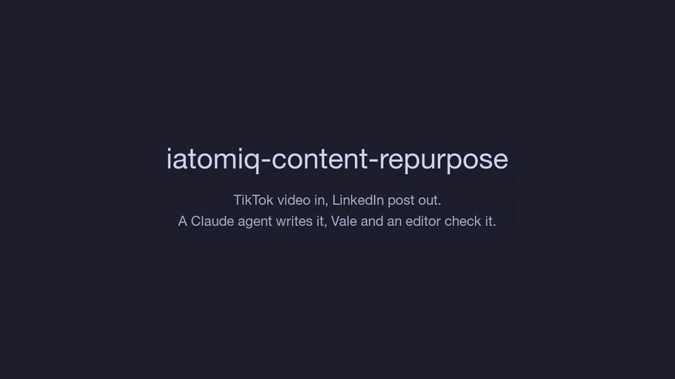

# iatomiq-content-repurpose

Turn a creator's TikTok videos into LinkedIn posts they publish as their own. You pick the LinkedIn author whose voice to copy, and the language.

You give it a TikTok account. For each of its most-played videos, a Claude agent reads the transcript and caption, looks through the video and picks screenshots to attach. Then it writes the post and rewrites it until a prose linter and a separate editor both accept it. The post never mentions TikTok or the original video.



The full-length demo is in [docs/demo.mp4](docs/demo.mp4).

It was built for [@iatomiq](https://www.tiktok.com/@iatomiq), a French creator who posts short AI tips, with posts styled on [Ruben Hassid](https://www.linkedin.com/in/ruben-hassid/). Both are flags, so any account and any LinkedIn author work.

## How it works

For each video, `postwriter` does this:

1. Fetches the video, its caption and its transcript from [ScrapeCreators](https://scrapecreators.com).
2. Fetches the reference author's recent LinkedIn posts with their like and comment counts, sorted best first. They are cached in `cache/`, so you pay for this once.
3. Downloads the video so the agent can look at any moment of it with ffmpeg.
4. Runs a Claude agent (Opus 5.5, through the Go SDK's tool runner) with three tools:
   - `view_frame` returns the video at a given second, full resolution.
   - `set_visuals` picks the 1 to 4 images attached to the post.
   - `review_post` runs [Vale](https://vale.sh) on the draft, then asks a second Claude call, the editor, to score it.
5. Saves the post, the images and a `meta.json` with every draft and score.

The facts in a post come only from the video. The reference posts are used only for style: hook shapes, line length, list format, how a post ends. The writer and the editor share one framework, in [`cmd/postwriter/prompts.go`](cmd/postwriter/prompts.go).
It covers the hook before LinkedIn's "see more" fold, copyable steps, proof taken from the source, and a single question at the end.

### The quality gate

A draft ships when Vale finds no errors and the editor's scores clear the bar. The editor scores hook, value, fidelity to the source, voice, how human it sounds, the closing line and language, each from 1 to 10. It also lists any claim the source doesn't support.

The bar was set by scoring the reference author's own best posts (`-calibrate 4`). They average about 7.5 with this editor. So a draft needs an average of 7.5, nothing under 6, fidelity of 8 and "human" of 7. A stricter bar meant the agent never finished, even though its drafts scored as well as the posts it was imitating.

The agent gets 4 reviews per post. In testing, most posts shipped in 2 to 4.

### The Vale rules

The rules live in [`vale/styles`](vale/styles):

- `LinkedIn` applies to every language: em dashes, more than 3 hashtags or emojis, repeated exclamation marks, sentences over 25 words, engagement-bait openers like 🚨.
<!-- vale off -->
- `LinkedInFR` and `LinkedInEN` catch phrases that read as AI filler in each language ("dans un monde où", "plongeons dans", "let's dive in", "game changer") and the "it's not X, it's Y" construction.
<!-- vale on -->

`postwriter` adds its own checks on top. It flags any mention of TikTok or the creator's handle, and Markdown, which LinkedIn doesn't render. It also flags links in the body, posts over 3,000 characters and hooks over 210 characters.

## Requirements

- Go 1.27 or newer
- [Vale](https://vale.sh) (`brew install vale`)
- [ffmpeg](https://ffmpeg.org) (`brew install ffmpeg`), for screenshots. Without it, posts are written from the transcript alone.
- A [ScrapeCreators](https://scrapecreators.com) API key
- An [Anthropic](https://platform.claude.com) API key

## Setup

```sh
git clone https://github.com/alexisbcz/iatomiq-content-repurpose
cd iatomiq-content-repurpose
cat > .env <<'EOF'
SCRAPECREATORS_API_KEY="..."
ANTHROPIC_API_KEY="..."
EOF
go build -o bin/ ./cmd/...
```

`.env` is in `.gitignore`.

## Usage

Repurpose an account's 3 most-played videos into French:

```sh
./bin/postwriter -handle iatomiq -n 3 -lang fr
```

One video, in English, attaching the frames where the prompt is typed:

```sh
./bin/postwriter -video https://www.tiktok.com/@iatomiq/video/7705825419664100640 -lang en \
  -overview 12 -visual-hint "frames where the prompt is typed in ChatGPT, paired with the result"
```

Use screenshots the creator chose instead, such as the comment section or a before/after:

```sh
./bin/postwriter -video <url> -images screenshots/ -lang fr
```

### Two ways to pick images

| Mode | Flag | What the agent does |
| --- | --- | --- |
| Agent captures | default | Gets 6 overview frames (or `-overview N`), looks closer with `view_frame`, attaches the frames that make people stop scrolling. |
| Creator screenshots | `-images` | Reads the screenshots as material, such as a question people keep asking in the comments. Picks which to attach, optionally with its own captures. |

`-visual-hint` steers either mode in plain words. `-visuals none` writes a text-only post.

### Flags

| Flag | Default | |
| --- | --- | --- |
| `-handle` | | TikTok account, repurposes its most-played videos |
| `-n` | 3 | how many videos with `-handle` |
| `-video` | | one video URL instead |
| `-lang` | `fr` | `fr`, `en`, `es`, `de`... Vale has dedicated rules for `fr` and `en` |
| `-formal` | off | "vous" instead of "tu", "Sie" instead of "du" |
| `-style` | Ruben Hassid | LinkedIn profile whose voice to imitate |
| `-images` | | creator screenshots (files or folders, comma-separated) |
| `-visual-hint` | | direction for which images to pick |
| `-overview` | 6 | frames shown to the agent up front |
| `-tag` | | suffix for the output folder, so a variant doesn't overwrite earlier posts |
| `-force` | off | redo videos that already have a post |
| `-effort` | `high` | writer effort: `low` to `max` |
| `-calibrate N` | | score the reference author's N best posts with the editor, then exit |
| `-refresh-style` | off | fetch the LinkedIn posts again instead of using the cache |

### Output

```
posts/<handle>/<video-id>-<lang>-<mode>[-<tag>]/
  post.txt        the post, ready to paste
  visual-1.jpg    images to attach, in order
  meta.json       source, scores, every draft and every review
```

Videos that already have a folder are skipped, so you can run the same command again after new uploads.

## The scraper

`tiktokscraper` lists an account's videos with their stats and can download them without the watermark:

```sh
./bin/tiktokscraper -handle iatomiq -limit 30 -download
```

It writes `output/<handle>/videos.json` and one `.mp4` per video.

## Costs

ScrapeCreators charges 1 credit per call. A post costs about 3 credits: video, transcript, and the account listing when you use `-handle`. Fetching the reference posts costs 1 credit plus 1 per post, once.

A post takes about 2 minutes and 5 to 10 Claude calls: the writer's turns, plus one editor call per review.

## Limitations

- The editor's scores are a proxy. Nothing here has been checked against real LinkedIn reach yet. `meta.json` keeps the scores and the chosen images for each post, so you can compare them with LinkedIn's stats once the posts are live.
- The rules and the reference author disagree in places. Ruben Hassid's best posts end with links and "repost this" calls to action, which the framework discourages. His numbers suggest those endings work for him.
- ScrapeCreators returns only the reference author's 8 most recent LinkedIn posts.
- The post is only as accurate as the video. If a video gets a command wrong, the post will too. When the caption and the screen disagree, check which one is right.
- Transcripts are generated automatically and get product names wrong. The agent corrects them only when the screen or the caption shows the right spelling.

## License

[MIT](LICENSE)
